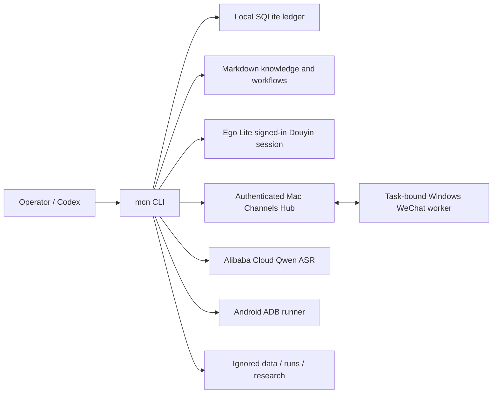

# Technical Specification

## Architecture

`codex-mcn-ops` is a Python 3.11+ CLI with a local SQLite ledger. It has no application server.



The Mac owns orchestration, persistence, review, media verification, transcription, and reporting. Windows owns only the authenticated WeChat session and one bounded Channels acquisition action at a time. Android apps own the final platform UI.

## Sources of truth

- SQLite schema and storage methods: `src/mcn_ops/store.py` plus explicit migrations under `src/mcn_ops/migrations/`.
- Collection states and legal transitions: `src/mcn_ops/collection/task_contracts.py`.
- Channels wire contract: `src/mcn_ops/collection/channels/contracts.py`.
- Creation stage contracts and validation: `src/mcn_ops/creation/contracts.py`.
- Creation orchestration: `src/mcn_ops/creation/workflow.py` and `stage_io.py`.
- Human-operable procedures: `workflows/` and current documents under `docs/`.

Do not maintain a second static creation JSON Schema. The Python contract generates the response template, validates submissions, and is covered by executable tests.

## Repository and runtime boundaries

Tracked:

- application code, tests, migrations, reusable scripts;
- current product/technical documents and stable protocol specifications;
- creation knowledge packs and reusable workflows.

Ignored/local-only:

- `data/`: SQLite databases, backups, caches, browser profiles, and runtime session state;
- `runs/`: job manifests, screenshots, logs, and sanitized run packages;
- `research/`: transcripts, candidate evidence, generated scripts, batch JSON, images, and investigation notes;
- `.env*`, credentials, cookies, signed media locators, certificates, and device-specific configuration.

## Data model

### Publishing

- `content_packages`
- `publish_jobs`
- `publish_run_logs`
- `tracking_snapshots`

### IP and collection

- `ip_roles`, `ip_role_versions`
- `collection_tasks`, `collection_task_roles`, `collection_runs`
- `source_authors`, `source_works`, `source_observations`
- `material_transcriptions`, `collection_candidates`, `collected_materials`
- `material_role_matches`, `material_inventory_classifications`, `material_creations`
- `provider_call_logs`, `provider_call_cache`, `material_understanding_logs`

Stable author/work identity is separated from time-varying observations. A transcription is provider/model/audio/options specific. Candidate status, formal material eligibility, role fit, inventory review, and creation usage are distinct decisions.

### Durable task orchestration

The additive `collection_task_orchestration_v1` migration adds:

- `collection_task_actions`
- `collection_task_events`
- `collection_task_frontiers`
- `collection_material_reviews`
- `channels_acquisition_sessions`
- `channels_acquisition_events`

Task state uses compare-and-swap `state_version`. Action idempotency keys bind to an input hash. Candidate persistence and frontier advancement share one transaction. A bounded page limit never implies source exhaustion.

### Creation

- `creation_tasks`
- `creation_stage_runs`
- `creation_material_selections`
- `creation_drafts`
- `creation_delivery_packages`
- `creation_feedback_events`
- `creation_stage_feedback_events`
- `risk_term_observations`
- `creation_learning_updates`

Stage runs are immutable versions. Script drafts are owned by Script Writer. Reviews bind to one Writer stage-run ID and body hash. A new body invalidates prior Quality and Risk passes.

## Collection architecture

### Douyin

The production route is `direct + aliyun`:

1. Ego Lite supplies the signed-in browser runtime for discovery, detail, and cursor pagination.
2. Authoritative detail is resolved before transcription.
3. Media/audio is normalized and sent to Qwen ASR.
4. Source identity, observations, transcript provenance, candidate decisions, and provider calls are persisted separately.

Risk-control pages, expired login, empty responses, cursor stalls, and unproven traversal completion fail closed. Static-signature HTTP access remains diagnostic-only.

### WeChat Channels

The provider key is `wechat_channels_remote`.

1. A durable Mac collection task plans one bounded persisted action.
2. A task-bound session controller starts or reuses the pinned Windows certificate/worker lease.
3. The authenticated Windows worker executes search, continuation, author, detail, public share-link, or media-locator work.
4. Mac resolves each formal candidate's stable work ID to a matching verified `https://weixin.qq.com/sph/...` source link, then persists candidates and traversal evidence, materializes a bounded shortlist, verifies media, and runs ASR.
5. Full-transcript semantic review writes the task review, role decision, inventory decision, task event, and progress atomically.
6. Completion or cancellation verifies pinned Windows cleanup before writing a terminal state.

Short-lived media URLs, decode keys, Hub secrets, cookies, and authorization headers never enter durable records. The public Channels source link is durable provenance; store insertion fails closed when a formal Channels material does not have a verified public share URL.

### Task completion

Raw results, saved transcripts, and automatic role matches are intermediate evidence. A role-targeted task completes only when the target number of distinct, unused source works have reviewed primary `formal_rewrite_base` classifications for the confirmed role.

## Content Creation Workflow v3

Adaptation and half-original stages:

```text
material_selection -> creation_brief -> script_writing
-> quality_review -> risk_review -> publish_format -> delivery
```

Original work starts at `creation_brief`.

`mcn create stage prepare` builds the context packet and response template. Codex produces one JSON response. `mcn create stage submit` runs structural and semantic gates before persisting a stage run. `create task run` is a deterministic fallback for testing or legacy execution and is not formal agent output.

### Ownership

- Script Writer is the only stage that creates or modifies viewer-facing copy.
- Quality Review and Risk Review are read-only and return bounded revision instructions.
- Publish Format packages the approved body but cannot rewrite it.

### Opening quality gate

Quality Review evaluates `贪、瞋、痴、慢、疑` with `strong`, `weak`, `absent`, or `artificial`.

- Evidence scope is spoken sentence one plus sentence two; sentence three is bridge/body.
- Both opening sentences must be strong and each must contain at least one exact strong-driver span.
- Together they require at least three organic strong drivers and four distinct literal topic-relevant high-stimulus keywords or phrases.
- Every strong driver requires an exact body-payoff span.
- Artificial drivers and unsupported stimulation cannot pass.

Legacy methodology-v2 stage records remain readable, but new formal tasks use v3.

## CLI surface

Primary command groups:

- `mcn db migrate-*`
- `mcn collect douyin ...`
- `mcn collect task keyword|author|discover-authors|show|report|resume`
- `mcn collect task plan|step|review|tune|cancel|recover-cleanup`
- `mcn collect task session-status|session-recover|session-close`
- `mcn material inventory classify|import|list|pending|summary`
- `mcn create task new|confirm|retry|report|export`
- `mcn create stage prepare|submit`
- `mcn publish prepare|push-assets|run|verify|feishu-payload`
- `mcn report daily`

## Migrations

Existing databases are upgraded only through explicit commands:

```bash
mcn --db-path data/mcn_ops.sqlite db migrate-collection-schema-v3 --json
mcn --db-path data/mcn_ops.sqlite db migrate-material-inventory-v1 --json
mcn --db-path data/mcn_ops.sqlite db migrate-collection-task-orchestration-v1 --json
```

Migrations must be idempotent where declared, run inside transactions, and finish with SQLite integrity and foreign-key checks. A schema-v3 rebuild writes a validated destination first; source replacement requires an explicit destination and recovery path.

## Publishing safety

- `publish run` stops before final submit by default.
- Live submit requires both `--allow-submit` and `--live`.
- Every device flow records screenshots, UI dumps when available, and run logs.
- UI changes are handled through platform/device calibration rather than private publishing APIs.

## Failure policy

Fail closed for:

- missing or unconfirmed IP roles;
- expired login, CAPTCHA, platform risk control, unavailable worker, or stale cursor;
- missing/invalid transcript or media verification failure;
- stale review hashes, invalid creation contracts, or missing body payoff;
- SQLite integrity, foreign-key, migration, or task-state conflicts;
- unverified Windows certificate/worker cleanup;
- any final publish action without explicit operator authorization.
